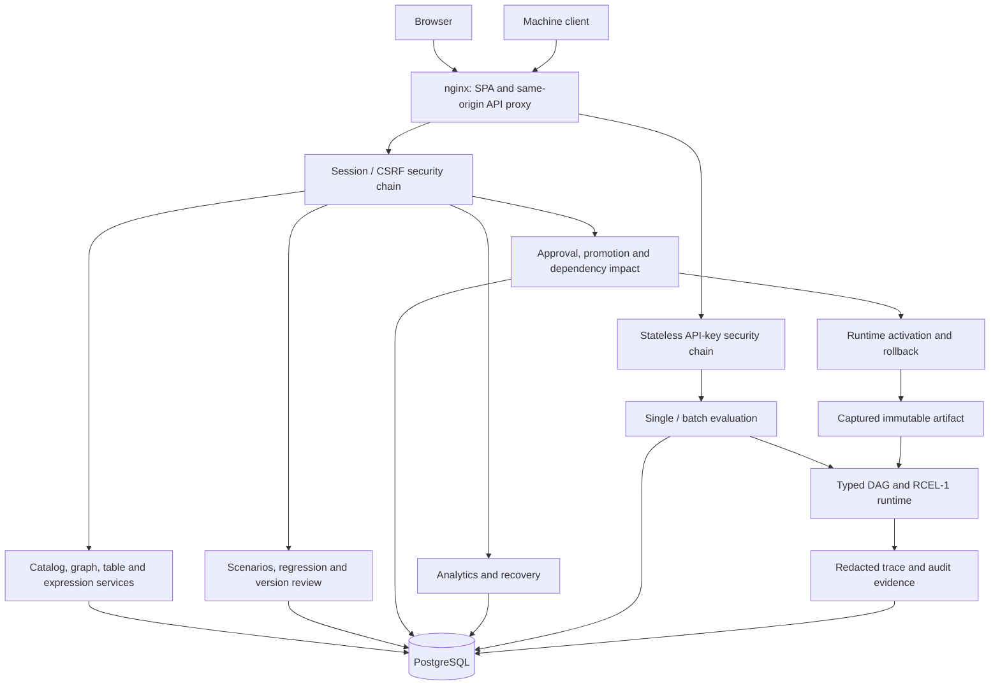
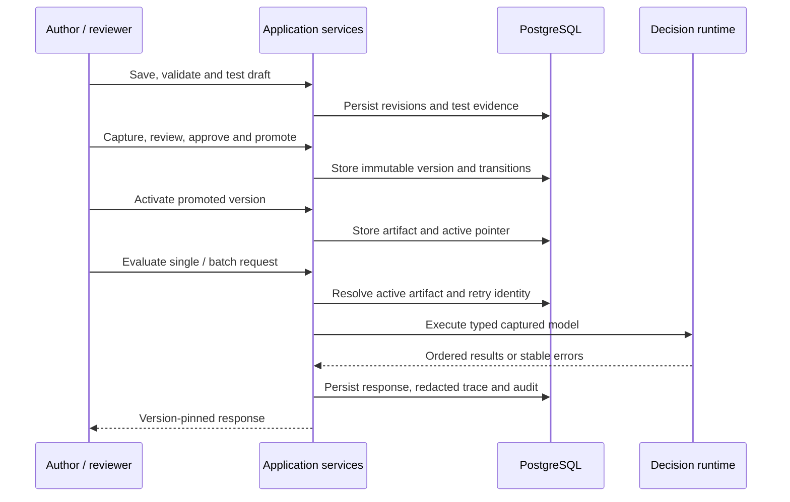

# Architecture

RuleCraft uses a Spring Boot modular monolith, a React client, and PostgreSQL. Domain packages keep rules and authorization close to the transactions they protect. There is no required broker, distributed cache, external workflow engine, or hosted service.

## Runtime boundaries

In production-shaped Compose, only the web edge is host-published, on loopback. API traffic uses port 8080 internally; health probes use a separate internal management port 8081. PostgreSQL stays on an internal network. TLS termination belongs to the host ingress.

## Module responsibilities

| Backend package | Responsibility |
|---|---|
| `platform` | Security chains, stable problems, headers, correlation, health and OpenAPI |
| `identity`, `projects`, `audit` | Tenants, accounts, sessions, memberships, access policy and audit events |
| `catalog` | Reusable types and service input/output contracts |
| `graph`, `tables`, `expressions` | Persisted typed authoring aggregates and validation |
| `runtime` | Working-copy evaluation and shared typed-value validation |
| `tests`, `simulation` | Scenarios, immutable comparisons and durable regression matrices |
| `versions`, `workflow` | Canonical snapshots, semantic diffs, approval and promoted baseline |
| `deployment`, `decisionapi` | Immutable activation, rollback, credentials, single/batch contracts and retry evidence |
| `explainability`, `impact` | Redacted execution evidence and transitive dependency assessment |
| `analytics`, `operations` | Trace-derived metrics, bounded benchmarks, posture and recovery |

HTTP controllers translate request/response contracts. Application services enforce domain invariants and project permissions. Repositories qualify sensitive lookups by tenant, project, and service; a client-supplied identifier never grants scope.

## Working state and immutable state

Authoring aggregates use optimistic revisions. Capturing a version snapshots the service contract, transitive referenced types, semantic graph, implementations, and scenarios. Canonical JSON and SHA-256 fingerprints make semantic identity stable; canvas coordinates and audit noise do not create a new behavior version.

Review packages refer to captured versions. Only the latest valid candidate may advance through the governed workflow. Promotion selects one baseline; activation validates and stores an immutable artifact. The runtime evaluates that artifact, not the mutable authoring tables. Retirement and rollback preserve the deployment timeline.

## Consistency and recovery

PostgreSQL is the only durable authority. Flyway owns forward migrations; Hibernate validates mappings instead of creating schemas. Service, environment, and tenant locks protect sequence allocation, promotion/activation, and recovery transitions where optimistic checks alone are insufficient.

Client request UUIDs provide idempotency for governed transitions and evaluation. Runtime evaluation stores canonical request hashes and version-pinned response evidence; changed reuse conflicts. Batch evaluation pins one active deployment, preserves item order and correlation IDs, and reports partial failures without changing other items into successes.

Regression runs persist per-case progress. Startup recovery marks interrupted work explicitly. The administrator recovery scan can interrupt tenant runs and clear inconsistent runtime pointers while retaining versions, approvals, deployment history, traces, and audits. Operators must coordinate recovery with active work; it is not a distributed worker-leasing system.

## Tradeoffs and limits

- A shared transaction/database boundary reduces deployment complexity but does not provide independent service scaling.
- Browser history and direct object routes are implemented in the client without a routing dependency; backend authorization remains authoritative.
- Regression execution, batches, and microbenchmarks are bounded and synchronous. No background queue, scheduling, or distributed execution is claimed.
- In-process rate controls reset on restart and do not coordinate across replicas.
- Analytics read a bounded newest-trace window. Benchmarks exclude HTTP, persistence, network, and concurrency.
- Trace redaction reduces exposure but does not anonymize all metadata. Idempotent response storage and test scenarios can retain business values; see [security](SECURITY.md).

The [architecture decisions](docs/adr/) record the detailed contracts. [Testing](docs/testing.md) explains the evidence and [operations](docs/operations.md) describes the deployment boundary.
