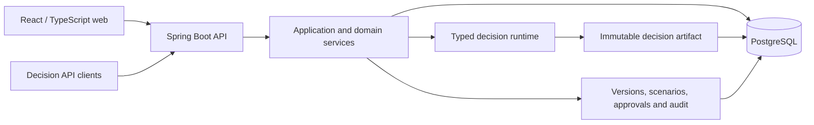
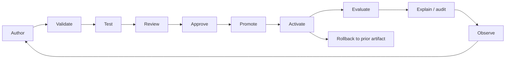
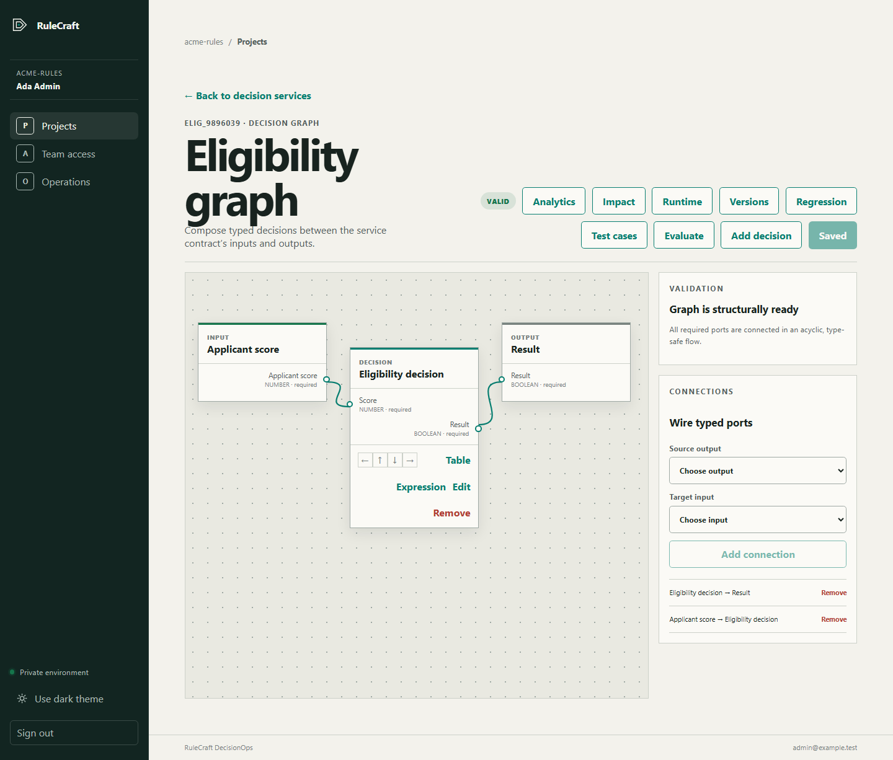
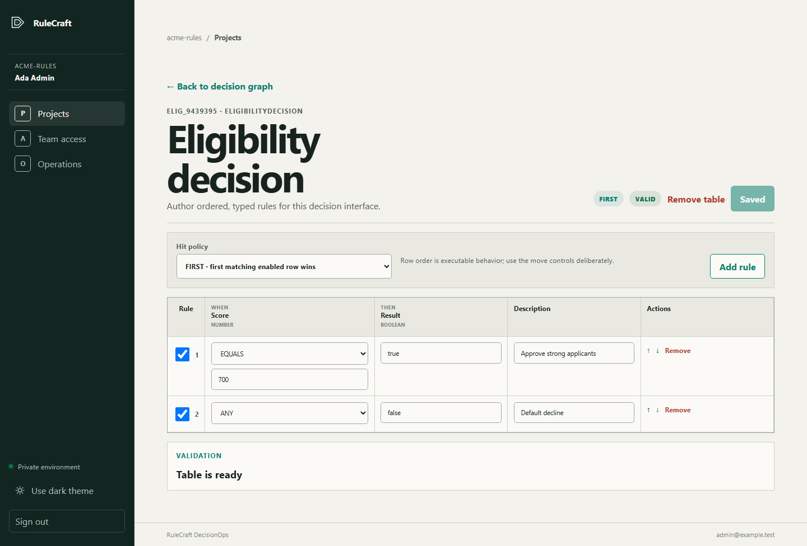

# RuleCraft DecisionOps

RuleCraft is a versioned business-rules and decision-management platform. It combines typed decision authoring with regression scenarios, review and approval, immutable runtime activation, and explainable single or batch evaluation.

## Why RuleCraft

A rule change affects more than its expression. Input contracts, dependent decisions, expected outcomes, approvals, and the artifact serving requests must stay consistent. RuleCraft keeps those concerns in one inspectable lifecycle, with PostgreSQL-backed evidence and server-enforced access control.

## Capabilities

| Work | Implemented behavior |
|---|---|
| Model | Project-scoped object, enum, and list types; typed service contracts; acyclic decision graphs |
| Author | Ordered decision tables with `UNIQUE` / `FIRST`; bounded RCEL-1 expressions and typed diagnostics |
| Validate | Contract and graph checks, implementation readiness, optimistic conflict detection |
| Test | Persisted scenarios, expected/actual comparisons, bounded regression matrices, CSV export |
| Govern | Immutable snapshots, semantic diff, dependency impact, review, approval, promotion |
| Execute | Immutable artifact activation, retirement and rollback; scoped API keys; idempotent single and batch requests |
| Explain | Ordered decision steps, matched-rule evidence, payload fingerprints, redacted traces and audit events |
| Operate | Trace-derived analytics, bounded engine benchmarks, readiness checks, recovery scans, backup/restore tooling |

These features use a deliberately documented DMN/FEEL-inspired subset. RuleCraft does not claim full DMN or FEEL conformance.

## Architecture



The backend is a modular monolith: domain packages share transactions without requiring a broker, cache, or separate workflow service. Browser sessions and machine API credentials use separate security filter chains. [Architecture and tradeoffs](ARCHITECTURE.md).

## Decision lifecycle



Authors work on mutable drafts. Review binds to an immutable captured version; promotion selects a governed baseline. Activation copies that artifact into the runtime environment. Later draft edits cannot silently change the decisions serving requests.

## Decision engine

- **Types:** built-in text, decimal number, boolean, date, and date-time values plus reusable object, enum, and list definitions. Inputs are validated recursively against their declared contracts.
- **Graphs:** exact-type ports and cycle prevention define the dependency DAG. Ready decision nodes execute in a stable key order.
- **Tables:** `ANY` and typed `EQUALS` cells feed ordered rules. `UNIQUE` requires a single match; `FIRST` selects the first matching enabled rule.
- **Expressions:** RCEL-1 uses an owned lexer, parser, type checker, and AST evaluator. It permits arithmetic, comparison, boolean logic, conditionals, field access, and a small allowlist of pure functions.
- **Failures:** invalid contracts, missing implementations, no-match tables, unsafe expressions, stale writes, and request conflicts produce stable problem codes. Batch items preserve their order and correlation IDs when individual evaluations fail.

See [decision-engine semantics](docs/decision-engine.md) and the [RCEL-1 language reference](docs/expression-language.md).

## Repository structure

```text
api/
  src/main/java/com/rulecraft/decisionops/  Domain modules and HTTP boundaries
  src/main/resources/db/migration/         Forward-only PostgreSQL migrations
  src/test/                               Backend correctness and security tests
web/
  src/                                    React workbenches and component tests
  e2e/                                    Browser acceptance journeys
docs/
  adr/                                    Architecture decisions
  product/                                Detailed user workflows
  operations/                             Deployment and recovery procedures
scripts/                                  Verification and operational tooling
.github/workflows/                         Build, integration and container gates
```

## Technology stack

| Component | Version |
|---|---|
| Java / Spring Boot | 25 / 4.1.1 |
| Maven Wrapper | Maven 3.9.11, wrapper 3.3.4 |
| PostgreSQL | 18.6 |
| React / TypeScript | 19.2.8 / 6.0.3 |
| Node.js / pnpm | 24.19.0 / 10.29.2 |
| Vite / Vitest / Playwright | 8.2.2 / 4.1.11 / 1.62.1 |
| OpenAPI generation | springdoc 3.1.0 |

Exact dependency versions live in `api/pom.xml` and `web/pnpm-lock.yaml`; container tags live in the Dockerfiles and Compose configuration.

## Getting started

Docker Engine or Docker Desktop with Compose is sufficient for a local container run. The web edge binds to `127.0.0.1:50113`; the API and PostgreSQL remain on private container networks.

1. Clone this repository and copy `.env.production.example` to `.env.local` (`cp` on macOS/Linux, `Copy-Item` in PowerShell).
2. Edit `.env.local`: choose a unique database password of at least 32 characters, set `RULECRAFT_BOOTSTRAP_ENABLED=true`, and choose the bootstrap administrator email and a unique password of at least 12 characters. Set `RULECRAFT_SESSION_COOKIE_SECURE=false` **only for this loopback HTTP run**. Retain `RULECRAFT_BIND_ADDRESS=127.0.0.1`.
3. Build and start:

   ```sh
   docker compose -f compose.production.yaml --env-file .env.local up -d --build --wait --wait-timeout 360
   ```

4. Open [the local workspace](http://127.0.0.1:50113) and sign in with the workspace and administrator credentials you configured.
5. Disable bootstrap, remove its password from `.env.local`, and recreate the API service with `docker compose -f compose.production.yaml --env-file .env.local up -d api`.

Stop while preserving data:

```sh
docker compose -f compose.production.yaml --env-file .env.local stop
```

Use `Secure` session cookies whenever the application is reached over TLS. See [operations](docs/operations.md) for native Java/Node development, resource requirements, troubleshooting, and backup/restore. Removing the PostgreSQL volume deletes the database.

## Testing

```sh
# Backend unit and integration tests, migration validation, and package
cd api
./mvnw verify                 # Windows: .\mvnw.cmd verify

# Frontend
cd ../web
pnpm install --frozen-lockfile
pnpm lint
pnpm test
pnpm build
```

Backend tests cover authorization, tenant isolation, schema evolution, graph/rule/expression correctness, version and promotion invariants, runtime retries, trace privacy, analytics, and recovery. Browser tests exercise persisted workflows at desktop and compact widths with one worker. [Test commands, fixtures, and coverage](docs/testing.md).

## Security

Tenant context is derived on the server. Project roles govern editing, review, and promotion. Browser writes require CSRF tokens; runtime API keys are scoped, revocable, and stored as digests. Expressions cannot access host code, files, environment variables, processes, or the network. Production containers run without root privileges and publish only the loopback web edge by default.

[Security boundaries, data retention, and reporting](SECURITY.md) also explain the limits of process-local rate controls and the operator responsibilities for TLS, shared limits, backups, and monitoring.

## CI

The verification workflow runs Maven verification, frozen frontend installation, lint, component tests, and a production build. Additional integration and container gates verify PostgreSQL, production Compose, private network exposure, image builds, and an application smoke path. Actions are pinned to commit SHAs. CI builds and validates artifacts; it does not deploy the application.

## API

The authenticated authoring API is rooted at `/api/v1`. Machine clients evaluate active artifacts through `/api/runtime/v1/decisions/{serviceKey}`. Local development publishes OpenAPI at `/v3/api-docs`; the production edge hides that route. See [API contracts and examples](docs/api.md).

## Screenshots

The examples below use synthetic decision data and test accounts.





## Documentation

- [Architecture](ARCHITECTURE.md)
- [Decision engine](docs/decision-engine.md) and [expression language](docs/expression-language.md)
- [API](docs/api.md), [testing](docs/testing.md), and [security](SECURITY.md)
- [Operations](docs/operations.md), [deployment contract](docs/operations/deployment-readiness.md), and [backup/restore](docs/operations/backup-restore-runbook.md)
- [Architecture decisions](docs/adr/) and [product workflows](docs/product/)

RuleCraft demonstrates production-oriented architecture and quality gates. Capacity planning, external-user accessibility validation, TLS ingress, secret management, off-host backup retention, monitoring, and any actual deployment require environment-specific validation.
